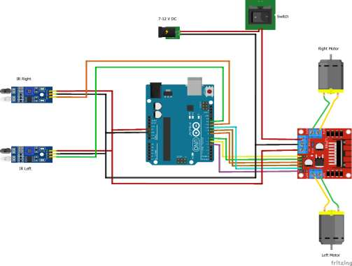
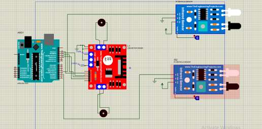
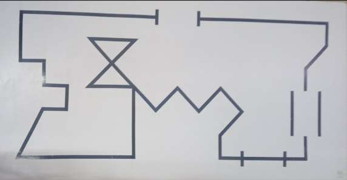

# Line Following Robot Using Arduino Uno

A line-following robot developed using Arduino Uno, two infrared (IR) sensors, an L298N motor driver, and DC motors.

**Author:** Muhammad Usman Shah

---

## Project Overview

This project involves the design and implementation of an Arduino-based robot that follows a black line on a white surface.

Two IR sensors detect the path, while the Arduino Uno controls the direction of two DC motors through an L298N motor driver.

The project includes circuit design, Arduino programming, Proteus simulation, and hardware testing.

## Circuit Diagram

[View Circuit Diagram](circuit_diagram.jpeg)

## Working Principle

The robot uses two IR sensors to distinguish between the black line and the white surface.

- **LOW:** White surface detected
- **HIGH:** Black line detected

The Arduino processes the sensor readings and controls the motors according to the following logic:

| Right IR Sensor | Left IR Sensor | Robot Action |
|-----------------|----------------|--------------|
| LOW | LOW | Move Forward |
| HIGH | LOW | Turn Right |
| LOW | HIGH | Turn Left |
| HIGH | HIGH | Stop |

When turning, one motor reverses while the other continues moving forward.

## Hardware Components

| Component | Project Image |
|-----------|---------------|
| Arduino Uno | [View](arduino_uno.jpeg) |
| L298N Motor Driver | [View](l298n_driver.jpeg) |
| IR Sensors | [View](ir_sensor.jpeg) |
| DC Motors | [View](dc_motor.jpeg) |
| Wheels | [View](wheels.jpeg) |
| Jumper Wires and Switch | [View](jumper_wires_and_switch.jpeg) |

**Power Supply:** 7–12 V

## Arduino Pin Configuration

| Component | Arduino Pin |
|-----------|-------------|
| Right IR Sensor | 11 |
| Left IR Sensor | 12 |
| Right Motor Enable (PWM) | 6 |
| Right Motor Inputs | 7, 8 |
| Left Motor Enable (PWM) | 5 |
| Left Motor Inputs | 9, 10 |

## Tools and Technologies

- Arduino Uno
- Arduino IDE
- Embedded C/C++
- Proteus
- IR Sensors
- DC Motor Control

## Project Files

| File | Description |
|------|-------------|
| [Arduino Source Code](line_following_robot.ino) | Robot control program |
| [Project Report](Line_Following_Robot_Report.pdf) | Complete project documentation |
| [Project Results](Line_Following_Robot_Results.pdf) | Simulation and experimental results |
| [Circuit Diagram](circuit_diagram.jpeg) | Hardware connections |
| [Proteus Circuit](proteus_circuit.jpeg) | Circuit simulation |
| [Robot Test Path](path_followed.jpeg) | Track used for robot testing |

## How to Run

1. Install the Arduino IDE.
2. Download the [Arduino source code](line_following_robot.ino).
3. Open `line_following_robot.ino` in Arduino IDE.
4. Connect the hardware according to the circuit diagram.
5. Select **Arduino Uno** as the board.
6. Select the correct port.
7. Upload the program to the Arduino.
8. Place the robot on the black-line track.
9. Turn on the power supply.

## Simulation and Results

### 1. Proteus Simulation

The circuit was designed and simulated using Proteus to examine the connections and motor-control operation.

[View Proteus Circuit](proteus_circuit.jpeg)

### 2. Path Followed

The robot was tested on a track containing straight sections and turns.

[View Testing Path](path_followed.jpeg)

### 3. Hardware Implementation

The physical robot uses an Arduino Uno, two IR sensors, an L298N motor driver, and two DC motors.

The IR sensor readings determine the motor movements, allowing the robot to follow the black line.

Detailed implementation results are available in the [Project Results](Line_Following_Robot_Results.pdf).

## Technical Notes

- The Arduino code modifies the Timer 0 prescaler for motor PWM control.
- Changing Timer 0 settings affects timing functions such as `delay()` and `millis()`.
- IR sensor thresholds may require adjustment depending on lighting conditions.
- The implemented circuit uses two IR sensors without an LCD.

## Limitations

- Sensor performance depends on lighting and surface contrast.
- Manual calibration may be required.
- Sharp turns can affect line tracking.
- The robot follows a predefined line rather than planning routes independently.

## Future Improvements

- PID-based motor speed control
- Additional IR sensors for improved detection
- Automatic sensor calibration
- Improved turning accuracy and speed control

---

## Author

**Muhammad Usman Shah**
